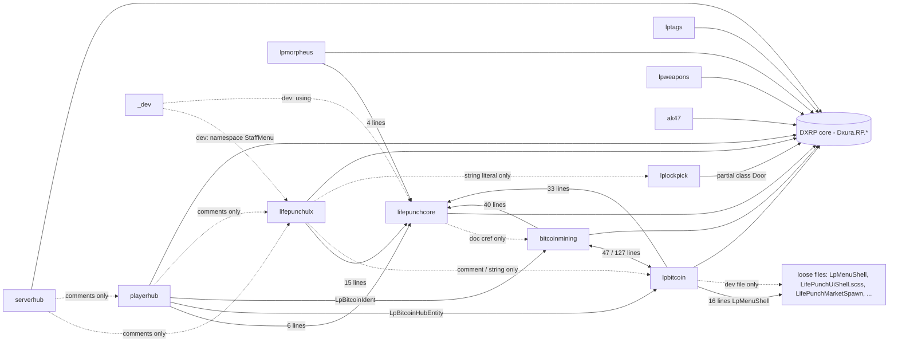

# Code census: game/Code/Addons/lifepunch

LifePunch internal working doc (not a dxrp.net/docs page). Sensed 2026-10-17 by seat CC-SIDE-PKG-1 (dispatch CC-SIDE-PKG-1 R1), read-only. Feeds the BTC-UI spec, the banker port and the package plan (`PACKAGE_SHAPE.md`, `PACKAGE_READINESS.md`).

All paths are relative to `game/Code/Addons/lifepunch/` unless they start with `game/`. Line numbers are against `develop` at `b3d3b525`. The live workbench tree is content-identical for this folder: 220/220 files are equal after LF normalization (SHA-256 per file, 2026-10-17).

## How this was sensed (and what it cannot see)

- One PowerShell pass over every `.cs` / `.razor` / `.scss` file. It records declarations (`class|struct|interface|enum|record`), `[ConCmd("...")]`, `[ConVar("...")]`, `[Rpc.*]` with the next method name, the money-rail names, shared-shell names, `namespace` / `using` lines, and `FileSystem.Data` / `Json.*` persistence.
- **Cross-addon edges** were first proposed by matching type names declared in one unit against identifiers in another. Each edge was then re-checked with a case-sensitive grep that **excludes comment lines and dev files** (`*DevSpawn*`, `*DevGive*`, `*DevChecks*`, `*TestBots*`). Only edges that survived are drawn solid.
- **DXRP core dependency** = identifiers that match type names declared in `develop`'s `game/Code` outside `Addons/lifepunch` (671 types). The matcher was case-insensitive and also counts words inside strings, so generic names (`Text`, `Status`, `Chat`, `Frame`, `Light`) are inflated. Read those columns as "which DXRP systems", not as exact counts.
- Not seen: reflection, string-keyed lookups, prefab/scene references to components, and any `#if` branch that never compiles. `LIFEPUNCH_LOCAL` (255 preprocessor lines) and `LIFEPUNCH_PACKAGE` (26, all in `lifepunchulx`) both split code, and neither is defined in `game/rp.sbproj:29`.

## Summary

| Unit | Purpose | cs/razor/scss | Bytes | Namespace | ConCmds | RPCs | Money rails | Razor |
|---|---|---|---|---|---|---|---|---|
| (8 loose files) | shared UI shell + market placement helper | 1/2/5 | 40,542 | `LifePunch.DXRP.Addons` (cs) | 0 | 0 | none | 2 |
| `_dev` | dev-only givers, test bots, map/space tools; never ships | 18/0/0 | 130,690 | `...Addons.Dev`, `...Addons.StaffMenu` | 40 (+1 ConVar) | 0 | none | 0 |
| `ak47` | AK-47 weapon code lane (quarantined product) | 3/0/0 | 48,716 | `...Addons.AK47` | 0 | 0 | none | 0 |
| `bitcoinmining` | bitcoin racks, terminal, wallet, economy, purchase flow, Portal economy sync (repoIdent of `lifepunch.bitcoin`) | 28/1/5 | 283,355 | `...Addons.Bitcoin` | 9 | 7 | PayHost, ChargeHost, RequestSetMining, RequestDepositRacksToHub | 1 |
| `keypadcracker` | design placeholder, no code | 0/0/0 | 713 | - | 0 | 0 | none | 0 |
| `lifepunchcore` | shared primitives: ownership, interact gates, input block, scroll regions, UI scale/footer, upgrade ledger + tracks, purchase event | 17/1/1 | 85,574 | `LifePunch.DXRP.Addons` | 0 | 0 | none (ledger persistence) | 1 |
| `lifepunchulx` | ULX staff menu (`lifepunch.ulx`) | 14/3/3 | 539,448 | `...Addons.StaffMenu` | 3 | 17 | staff money grant (PayHostStrictAudited) | 3 |
| `lockpick` | design placeholder, no code | 0/0/0 | 734 | - | 0 | 0 | none | 0 |
| `lpbitcoin` | bitcoin hub entity (HASHD hub), hub panel, hub dev spawn | 7/1/1 | 448,683 | `...Addons.Bitcoin` | 52 (dev) | 26 | SetPowered, RequestDepositRacksToHub, RequestCashOutAllHub, TryPayBank | 1 |
| `lplockpick` | lockpick equipment + pin-tumbler minigame + `Door` partial | 4/1/1 | 61,749 | `Dxura.RP.Game`, `...Addons.Lockpick` | 0 | 11 | none | 1 |
| `lpmorpheus` | town-hall chamber entity with TTS briefing | 5/1/1 | 29,629 | `...Addons.Morpheus` | 0 | 2 | none | 1 |
| `lptags` | name tags/effects on chat, nameplate and scoreboard (`lifepunch.tags`) | 24/2/3 | 404,769 | `...Addons.Tags` | 2 | 0 | none | 2 |
| `lpweapons` | weapon attachment system | 5/0/0 | 51,650 | `...Addons.Weapons.Attachments` | 0 | 3 | none | 0 |
| `playerhub` | Player Hub menu with a live $BTC tab | 4/8/10 | 120,480 | `...Addons.PlayerHub` | 3 | 1 (source) | calls lpbitcoin rails only | 8 |
| `safe` | design placeholder, no code | 0/0/0 | 738 | - | 0 | 0 | none | 0 |
| `serverhub` | Server Hub menu: jobs, shop, info, banker socket | 5/5/7 | 92,543 | `...Addons.ServerHub` | 2 | 1 (shop) | rides `GameManager.PurchaseMarketItemHost` | 5 |

Byte counts are from the live tree (CRLF). Purpose sources: the unit READMEs (`lpbitcoin/README.md`, `serverhub/README.md:1-7`, `ak47/README.md:1-4`, `lptags/tags/README.md:4`, `{safe,keypadcracker,lockpick}/README_DESIGN.md:1-7`) and the XML summaries of the entry types cited below.

## Dependency graph (verified compile references)

Solid = a non-comment, non-dev code reference. Dotted = a mention that does not bind at compile time (doc comment, string, comment, or dev-only file). Evidence:
- `bitcoinmining -> lpbitcoin`, e.g. `bitcoinmining/LpBitcoinPurchaseFlow.cs:56`.
- `lpbitcoin -> bitcoinmining`, e.g. `lpbitcoin/bitcoinhub/code/components/LpBitcoinHubEntity.cs:61`.
- `lpbitcoin -> LpMenuShell` at `lpbitcoin/bitcoinhub/code/ui/LpHashdPanel.razor:91`, `:1037`.
- `playerhub -> lpbitcoin` at `playerhub/code/data/LpPlayerHubBtcSource.cs:31-34`; `playerhub -> bitcoinmining` at `:94-95`.
- `lpmorpheus -> lifepunchcore` at `lpmorpheus/LpMorpheusEntity.cs:92`.
- `lifepunchcore -.-> bitcoinmining` at `lifepunchcore/LifePunchTerminalLcd.cs:16` (`<see cref>`).
- `lifepunchulx -.-> lplockpick` at `lifepunchulx/StaffMenuHost.cs:1596` (the string `"Lockpick"`).
- `lpbitcoin -.-> LifePunchMarketSpawn` at `lpbitcoin/bitcoinhub/code/components/LpBitcoinDevSpawn.cs:31`.
- `_dev` uses the `LifePunch.DXRP.Addons.StaffMenu` namespace (census `namespace` lines).

**Reading:** `lpbitcoin` and `bitcoinmining` are one compile unit in practice (same namespace `LifePunch.DXRP.Addons.Bitcoin`, references both ways). `playerhub` cannot compile without both. `serverhub`, `lptags`, `lplockpick`, `lpweapons` and `ak47` reference no other LifePunch unit.

## Money rails (every site)

The direct `$` mutations in this folder all go through one wrapper, `bitcoinmining/LpBitcoinWallet.cs`:

| Wrapper | DXRP call | Line | Callers (non-comment) |
|---|---|---|---|
| `TryCharge(callerId, amount, reason)` | `player.ChargeHost(amount, reason)` | `:18`, `:25` | **none found** |
| `TryPayWallet(...)` | `player.PayHost(amount, reason)` | `:30`, `:37` | **none found** |
| `TryPayBank(...)` | `player.PayHost(amount, reason, inBank: true)` | `:42`, `:49` | `bitcoinmining/LpBitcoinCashRedeemEntity.cs:61` (Portal $BTC item redeem); `bitcoinmining/LpBitcoinRackEntity.cs:358` (rack sell, `SellHost` `:337`); `lpbitcoin/bitcoinhub/code/components/LpBitcoinHubEntity.cs:1187` (hub cash-out, `CashOutHubHost` `:1162`) |

The DXRP core signatures they ride: `ChargeHost` (`game/Code/Player/Player.Roleplay.cs:88`, `:91`), `PayHost` (`:226`, `:229`).

Other money paths:
- **Staff grant (ULX)**: `GiveMoneyHost` (`lifepunchulx/StaffMenuBridgeService.cs:308`) -> `ExecuteGiveMoneyAsync` -> `target.PayHostStrictAudited(...)` (`:433`). That API is `internal` in fork core (`game/Code/Player/Player.Roleplay.cs:304`) and is fenced `#if !LIFEPUNCH_PACKAGE` (`:419`). It also gates on the server API key and `Config.Current.Game.MoneyEnabled` (`:367`, `:373`).
- **Shop debit (serverhub)**: `manager.PurchaseMarketItemHost(item.Id)` (`serverhub/code/ui/Shop/LpServerHubShopActions.cs:113`), DXRP's host rail (`game/Code/GameManager.cs:336`), which "returns early unless ChargeHost succeeds" (`LpServerHubShopActions.cs:38-41`). The file documents why it must never call `PurchaseEntityHost` (`:44-47`).
- **BTC-denominated (not `$`)**: the compute-tier purchase debits the hub's BTC wallet and restores it on failure (`bitcoinmining/LpBitcoinPurchaseFlow.cs:104-115`). The purchase is recorded in `lifepunchcore/LifePunchUpgradeLedger.cs` (persistence below).

**lpbitcoin entity rails** (public wrapper -> `[Rpc.Host]`):

| Rail | Declared | Host RPC | UI / command callers |
|---|---|---|---|
| `SetPowered(bool)` | `lpbitcoin/.../LpBitcoinHubEntity.cs:321` | `SetPoweredHost` `:337` | `playerhub/code/data/LpPlayerHubBtcSource.cs:127`; `lpbitcoin/bitcoinhub/code/ui/LpHashdPanel.razor:2433`, `:2435` |
| `RequestSetMining(bool)` | `bitcoinmining/LpBitcoinRackEntity.cs:310` | `SetMiningHost` `:312` | `LpPlayerHubBtcSource.cs:106`; `bitcoinmining/LpBitcoinTerminalCommands.cs:290`, `:305`, `:331`, `:338`; dev `LpBitcoinDevSpawn.cs:312` |
| `RequestDepositRacksToHub()` | `LpBitcoinHubEntity.cs:436` | `DepositRacksToHubHost` `:1141` | `LpPlayerHubBtcSource.cs:134`; `LpBitcoinTerminalCommands.cs:387` |
| `RequestCashOutAllHub()` | `LpBitcoinHubEntity.cs:442` (also via `RequestSellAllRacks` `:469`) | `CashOutHubHost` `:1162` | `LpPlayerHubBtcSource.cs:141`; `LpHashdPanel.razor:1675-1676`, `:2962` |

`playerhub` owns no money code, by its own statement (`LpPlayerHubBtcSource.cs:10-11`); it calls the entities' existing rails. **HASHD** is a display brand, not an API: `"HASHD Terminal"` (`bitcoinmining/LpBitcoinIdent.cs:413`), `"HASHD Hub"` (`LpHashdPanel.razor:2240`), hack-attempt alerts (`LpBitcoinHubEntity.cs:825`, `:842`; `lpbitcoin/.../LpBitcoinHubAlertBridge.cs:12` "cross-lane entry for hacker vengeance ops"), and one active hub per operator (`LpBitcoinHubEntity.cs:1339-1352`).

## UI surfaces and which shell they use

| Unit | Razor (root component first) | Shared shell pieces used |
|---|---|---|
| loose | `LpMenuShell.razor` (Panel; nested types `NavItem`, `DoorCard`, `StatusChip`, `StatRow`, `QuickButton` `:235-292`), `LifePunchCurrencyToken.razor` (Panel) | `LpMenuShell` uses `LifePunchCurrencyToken` (`:174`) and `LifePunchUiFooter` (`:216`) |
| `lpbitcoin` | `bitcoinhub/code/ui/LpHashdPanel.razor` (PanelComponent) | **LpMenuShell** (`:91`), LifePunchCurrencyToken (`:119`...), LifePunchUiFooter (`:85`); SCSS imports LifePunchUiShell (`LpHashdPanel.razor.scss:43`) |
| `bitcoinmining` | `LpBitcoinTerminalPanel.razor` (PanelComponent) | LifePunchUiFooter (`:155`); SCSS imports LifePunchUiShell (`LpBitcoinTerminalPanel.razor.scss:23`); keeps its own `LpUiScale`/`LpUiScaleSize` (`LpUiScale.cs:14`, `:23`), parallel to core's `LifePunchUiScale` |
| `lifepunchulx` | `StaffMenu.razor` (PanelComponent), `observe/StaffObserve.razor`, `observe/StaffChatPanel.razor` | LifePunchUiFooter (`StaffMenu.razor:1582`), LifePunchUiScale (`:3636`) |
| `playerhub` | `code/ui/LpPlayerHubRoot.razor` (PanelComponent) + 7 tab/child Panels (Btc, Overview, Stats, Skills, Store, Empty, Error) | LifePunchUiFooter (`LpPlayerHubRoot.razor:88`) |
| `serverhub` | `code/ui/LpServerHubRoot.razor` (PanelComponent) + Banker, Info, Jobs, Shop Panels | none of the shared shell names |
| `lptags` | `tags/code/ui/LpTagsMenu.razor` (PanelComponent), `tags/code/rendering/LpTagName.razor` (Panel) | none |
| `lplockpick` | `LockpickMinigame.razor` (PanelComponent) | none |
| `lpmorpheus` | `UI/MorpheusReadout.razor` (PanelComponent) | none |
| `lifepunchcore` | `LifePunchUiFooter.razor` (Panel) | is the footer |

So `LpMenuShell` has exactly one consumer today (`lpbitcoin`). `LifePunchUiFooter` (in `lifepunchcore`) is the most shared piece: 5 consumers.

## Per unit

### Loose files (8)
- `LifePunchMarketSpawn.cs`: `public class LifePunchMarketSpawn` (`:19`), the "DXRP market placement law" (spawn at `GameUtils.GetSpawnPosition(player.AimRay)`, identity rotation). Its only caller is a dev file (see graph).
- `LpMenuShell.razor` + `.razor.scss`, `LifePunchUiShell.scss`, `LifePunchUiScale.scss`, `LifePunchUiFooter.razor.scss`, `LifePunchCurrencyToken.razor` + `.razor.scss`: shared UI shell and tokens. Under the publish doctrine these are "primitives only" and must be copied into each package that uses them (`PACKAGE_SHAPE.md` section 4).

### `_dev` (never ships)
Givers and spawners: `lp_give_ak`, `lp_give_lockpick`, `lp_spawn_morpheus`, `lp_morpheus_walkup`, the `lp_*_grok` / `lp_*_fred` / `lp_*intellibot` set (`IntellibotSession.cs:39-181`), `lp_map*` (`MapWorkspaceDev.cs:34-60`), `lp_fit_test` / `lp_fit_clear` and ConVar `lp_test_space` (`TestSpaceDev.cs:58-76`), plus the ULX test-bot and rank commands (`StaffMenuTestBots.cs:225-981`, e.g. `ulx_bots`, `lifepunch_spawn_testbot`). It has a `GameObjectSystem` `TestSpaceSystem` (`TestSpaceDev.cs:252`). `StaffMenuTestBots` lives in namespace `LifePunch.DXRP.Addons.StaffMenu`, ULX's namespace.

### `ak47`
Types `AK47` (`AK47.cs:14`), `AK47WeaponStats` (`:53`), `AK47Weapon : Component` (`AK47Weapon.cs:16`), `Ak47HoldIk : Component` (`Ak47HoldIk.cs:25`). Uses DXRP `Equipment`, `Player`, `AnimationHelper`. No ConCmd/RPC. Docs in `ak47/docs/`.

### `bitcoinmining`
- **Entry points (components/entities)**: `LpBitcoinRackEntity` (`:24`/`:26`, `Component` vs `BaseEntity` under `#if LIFEPUNCH_LOCAL`), `LpBitcoinTerminalEntity` (`:23`/`:25`), `LpBitcoinCashRedeemEntity : BaseEntity` (`:27`), `LpBitcoinPortalEconomySync : SingletonComponent` (`:30`), `LpBitcoinRackVisuals : Component` (`:21`).
- **Public API**: `LpBitcoinEconomy` (`:17`), `LpBitcoinIdent` (`:15`), `LpBitcoinRackConfig` (`:43`), `LpBitcoinPayoutQuote` (`LpBitcoinDonorPayout.cs:34`), `LpBitcoinPowerAnim`, `LpBitcoinPowerLeds`, `LpBitcoinUiSounds`, `LpBitcoinScrollRegionFactory`, `LpBitcoinTerminalCommandInput : TextEntry`, `LpBitcoinTerminalScreen`, `LpOpsCrtTheme`, `LpUiScale`. Wallet, purchase flow, terminal commands, donor policy and payout math are `internal`.
- **ConCmds**: dev ledger tools `lp_bitcoin_dev_buy_tier|fund_wallet|corrupt_tier|reconcile|ledger` (`LpBitcoinLedgerDevSpawn.cs:30-114`); Portal sync `lp_bitcoin_portal_sync` (`LpBitcoinPortalEconomySync.cs:97`), `lpbitcoinreloadconfig` (`:132`), `lp_bitcoin_portal_rate` (`:160`), `lp_bitcoin_portal_redeem_rate` (`:204`).
- **RPCs**: `RequestPortalEconomyHost` / `BroadcastPortalEconomyClient` (`LpBitcoinPortalEconomySync.cs:433`, `:439`); `SetMiningHost`, `SellHost`, `PurchaseComputeTierHost` (`LpBitcoinRackEntity.cs:312`, `:337`, `:392`); `OpenTerminalHost` / `OpenTerminal` (`LpBitcoinTerminalEntity.cs:335`, `:362`).
- **Config / persistence**: Portal economy mirrored per peer from a Portal inventory item, with JSON and token-scoped store overrides (`LpBitcoinPortalEconomySync.cs:30` summary); `LpBitcoinRackConfig`. DXRP systems used: `ServerApiClient`/`ServerApiLink`, `ItemDefinitionDto`, `HealthComponent`, `DamageInfo`, `RankSystem`, `GameManager`.
- **Depends on**: `lifepunchcore` (e.g. `LpBitcoinHubLogsScrollPanel : LifePunchScrollRegionPanel`, `LpBitcoinHubLogsScrollPanel.cs:20`; `ILifePunchPurchaseEvent`, `LpBitcoinLedgerDevSpawn.cs:206`), `lpbitcoin` (both ways).

### `keypadcracker`, `lockpick`, `safe`
Design placeholders only. Each README says "No code copied", module class equipment, models principal-sourced, folder and portal identifier **OPEN (Q1)** (`*/README_DESIGN.md:1-14`).

### `lifepunchcore`
- **Public API**: `ILifePunchPurchaseEvent : ISceneEvent<...>` (`ILifePunchPurchaseEvent.cs:25`), `LifePunchEntityOwnership`, `LifePunchGroundContact`, `LifePunchInteractTags`, `LifePunchMachineDestroyFx`, `LifePunchMenuInputBlock` (+ internal `LifePunchMenuInputGuard : Component`), `LifePunchMenuInteractGate`, `LifePunchMenuInteractRange`, `LifePunchPropPhysics`, `LifePunchScrollRegionPanel : Panel` + `LifePunchScrollRegionBootstrap`, `LifePunchSourceMark`, `LifePunchTerminalLcd`, `LifePunchUiScale` / `LifePunchUiScaleSize`, `LifePunchUiScrollPolicy`, `LifePunchUpgradeLedger` + `LifePunchPurchaseRecord`, `LifePunchUpgradeTracks` + `LifePunchTrackDef` + `LifePunchTrackSubjectKind`.
- **Persistence**: `LifePunchUpgradeLedger` is "host-only, append-only... THE source of truth for upgrade ownership", stored in host `FileSystem.Data` and flushed at every commit (`LifePunchUpgradeLedger.cs:51-58`; read `:237-244`; write `:260`).
- **Config**: reads `Config.Current.Game` (4 sites).
- No ConCmd, no RPC. It is the shared library every bitcoin, ULX, hub and morpheus build needs.

### `lifepunchulx`
- **Entry points**: `StaffMenuBridgeService : SingletonComponent` (`StaffMenuBridgeService.cs:30`), `StaffMenu.razor` (PanelComponent), `StaffMenuHost` (internal, `StaffMenuHost.cs:198`), chat commands `StaffMenuChatCommand : ICommand` (`:2744`) and `SetArmorCommand : ICommand` (`Commands/SetArmorCommand.cs:23`).
- **ConCmds**: `lifepunchulx`, `menu`, `ulx` (`StaffMenuHost.cs:595`, `:598`, `:601`).
- **RPCs (17)**: Host `RequestAuditHost` `:70`, `SetStatusToggleHost` `:214`, `RequestWaypointsHost` `:282`, `GiveMoneyHost` `:307`, `QueryMoneyGrantResultHost` `:527`, `RequestSettingsHost` `:565`, `SetWebsiteHost` `:587`, `RequestInventoryHost` `:624`, `RequestSanctionsHost` `:774`; Broadcast `ReceiveAuditClient` `:1141`, `ReceiveWaypointsClient` `:1169`, `ReceiveSettingsClient` `:1175`, `ReceiveWebsiteWriteResultClient` `:1181`, `ReceiveMoneyGrantResultClient` `:1187`, `ReceiveMoneyGrantReconcileStateClient` `:1193`, `ReceiveInventoryClient` `:1199`, `ReceiveSanctionsClient` `:1214` (all in `StaffMenuBridgeService.cs`).
- **Public API**: `StaffMenuActions` / `StaffAction` / `StaffActionArg` and the `Staff*` enums (`StaffMenuActions.cs:18-276`), `StaffMenuConfig` (`:276`), `StaffActionTaxonomy`, `StaffAuditWireRow`, `LpParityCatalog`, the `Staff*` row records in `StaffMenuHost.cs:32-189`, the `Observe*` row/VM records (`observe/`), `StaffXrayIcon : Image`.
- **Config / persistence**: host bridge for "the server token store" without replicated `[Sync]` state (`StaffMenuBridgeService.cs:30` summary); a local audit store (`LocalAuditStore.SnapshotNewestFirst`, 3 sites); `Config.Current.Game` / `.GameMode` (7 sites). DXRP systems: `Player`, `RankSystem`, `Permission`, `Chat`, `Sentinel`, `ServerApiClient`/`ServerApiLink`, `PocketSystem`, `HealthComponent`.
- **Package branch**: the only unit with `LIFEPUNCH_PACKAGE` code (26 preprocessor lines).

### `lpbitcoin`
- **Entry points**: `LpBitcoinHubEntity` (`bitcoinhub/code/components/LpBitcoinHubEntity.cs:23`/`:25`: "Hub - PIN, power, linking, upgrades (purchased here). No mine/sell on hub UI."), `LpBitcoinHubVisuals : Component` (`LpBitcoinHubVisuals.cs:20`), `LpHashdPanel.razor` (PanelComponent), `LpHashdUiHost` (internal).
- **RPCs (26)**, all in `LpBitcoinHubEntity.cs`: Host `OpenHubHost` `:298`, `SetPoweredHost` `:337`, `UnlinkRackByTokenHost` `:529`, `LinkNearbyTerminalHost` `:555`, `UnlinkTerminalHost` `:600`, `LinkNearbyRackHost` `:614`, `LinkRackByTokenHost` `:673`, `ReportHackAttemptHostRpc` `:835`, `MarkAlertsReadHost` `:855`, `ClearAlertsHost` `:864`, `PushTerminalCommandAlertHost` `:874`, `SetAccessPinHost` `:922`, `UnlockAccessPinHost` `:989`, `RequestTerminalUnlockHost` `:1030`, `ChangeAccessPinHost` `:1085`, `DepositRackHost` `:1123`, `DepositRacksToHubHost` `:1141`, `CashOutHubHost` `:1162`, `SendHubWalletHost` `:1214`, `PurchaseComputeTierHost` `:1304`; Broadcast `OpenHub` `:312`, `NotifyTerminalUnlockResult` `:1071`, `NotifyCashOutSuccess` `:1254`, `NotifyPinResult` `:1268`, `NotifyPinChangeResult` `:1282`, `NotifyPurchaseResult` `:1318`.
- **ConCmds (52)**: all in `bitcoinhub/code/components/LpBitcoinDevSpawn.cs:25-1459` (`lp_bitcoin_spawn_*`, `lp_bitcoin_preview_*`, `lp_bitcoin_*_audit`, `lp_spawn_*gpu_rack`, `lp_hashd_pin_preview`, `lp_bitcoin_ui_close`, ...). A dev file by name, but it sits in the shipping folder.
- **Public API**: `LpBitcoinHubAlert` / `LpBitcoinHubAlertKind`, `LpBitcoinHubAlertBridge` (cross-lane hacker alert entry, `LpBitcoinHubAlertBridge.cs:12-13`), `LpBitcoinDevSpawn`.
- **Other files**: `bitcoinhub/code/manifest.json`, READMEs.

### `lplockpick`
- **Entry points**: `LockpickEquipment : InputWeaponComponent` (`LockpickEquipment.cs:27`: "Structural mirror of Dxura.RP.Game.Equipments.PryBarEquipment"), `LockpickMinigameEquipment : LockpickEquipment` (`LockpickMinigameEquipment.cs:337`), `LockpickRelockTimer : Component` (`LockpickEquipment.cs:447`), `LockpickMinigame.razor`.
- **Extends DXRP core**: `public partial class Door` in `namespace Dxura.RP.Game` (`Door.Lockpick.cs:12-18`); `LockpickMinigameEquipment.cs:19` also sits in `Dxura.RP.Game`. Public `GameConfig` (`LockpickMinigameEquipment.cs:22`) is declared inside DXRP's namespace.
- **RPCs (11)**: Host `StartPickHost` `:213`, `CompletePickHost` `:242`, `DoPickEffectsHost` `:353`, `CancelPickHost` `:397`; Broadcast `BroadcastPickEffects` `:365` (all `LockpickEquipment.cs`); Host `BeginAttemptHost` `:498`, `CompleteAttemptHost` `:583`, `CancelAttemptHost` `:629`; Owner `BeginAttemptOwner` `:546`, `RejectAttemptOwner` `:573`, `CloseAttemptOwner` `:638` (all `LockpickMinigameEquipment.cs`).
- **Config**: `Config.Current.Game` (22 sites). DXRP systems: `Equipment`, `Door`, `Cooldown`, `Notify`, `IInputHints`, `IEquipmentEvents`, `BreachSystem`.

### `lpmorpheus`
`LpMorpheusEntity` (`:31`/`:33`: "Town-hall chamber: public press, host-built file or civic briefing, one parented TTS voice"), `LpMorpheusHud`, `LpMorpheusSpeech`, `LpMorpheusSpeechCases`, `LpMorpheusReadout` (+ kind enum). RPCs: Host `RequestBriefingHost` (`LpMorpheusEntity.cs:103`), Broadcast `PlayBriefing` (`:141`). Uses `Sandbox.Speech` / `Sandbox.Audio` and DXRP `WantedStatus`, `Governance`, `Status`. Depends on `lifepunchcore` (`LifePunchMenuInteractGate`, `LpMorpheusEntity.cs:92`, `:107`, `:126`).

### `lptags`
- **Entry points**: `LpTagAnimationScheduler : Component` (`tags/code/rendering/LpTagAnimationScheduler.cs:23`), `LpTagsMenuHost` (`tags/code/ui/LpTagsMenuHost.cs:27`), `LpTagsMenu.razor` (PanelComponent).
- **ConCmds**: `lifepunchtags`, `tags` (`LpTagsMenuHost.cs:155`, `:158`).
- **Public API**: chat, nameplate and scoreboard adapter interfaces (`tags/code/adapters/ILpTag*Adapter.cs`); effect catalog, evaluator, frames and phases (`tags/code/core/`); profile client and messages (`tags/code/network/`); profile store, preferences and rules (`tags/code/profile/`); `LpTagNamePresenter`.
- **Persistence**: `ILpTagProfileStore` (`tags/code/profile/ILpTagProfileStore.cs:42`) with versioned records `LpStoredTagPreferencesV1`, `LpTagProfileWritePayloadV1` (`LpTagPreferences.cs:19`, `:26`); viewer preferences store (`LpTagViewerPreferenceStore.cs:19`); a local profile client (`LpTagLocalProfileClient.cs:19`). The concrete storage backend was not traced: UNKNOWN.
- **Dev code inside**: `tags/code/dev/LpTagDevChecks.cs` (internal checks).
- **Third party**: Roboto Mono font under OFL-1.1 with its licence file (see `PACKAGE_READINESS.md`). README declares "s&box ident: lifepunch.tags, addon ident: lptags" (`lptags/tags/README.md:4`).

### `lpweapons`
`WeaponAttachmentController : Component` (`attachments/WeaponAttachmentController.cs:10`), `WeaponAttachmentRenderController : Component, IDroppedWeaponPresentationSource` (`WeaponAttachmentRenderController.cs:7`), `WeaponAttachmentState : Component` (`WeaponAttachmentState.cs:7`), contract types (`WeaponAttachmentContract.cs:7-556`: kinds, slots, loadout codec, compatibility, transaction controller, catalog, gateways), chat command `WeaponAttachmentCommand : ICommand` with alias `attachment` (`WeaponAttachmentCommand.cs:6`, `:9`). RPCs: Host `AttachHost` `:29`, `DetachHost` `:40`, `SetLaserEnabledHost` `:51` (`WeaponAttachmentController.cs`). DXRP systems: `Equipment`, `ServerApiClient`, `GiveItemDto`, `DroppedEquipment`, `IEquipmentSnapshotState`.

### `playerhub`
- **Entry points**: `LpPlayerHubHost` (`code/ui/LpPlayerHubHost.cs:35`; the panel exists only while open, the house pattern copied from `StaffMenuHost`), `LpPlayerHubRoot.razor` (PanelComponent), chat command `LpPlayerHubChatCommand : ICommand` with alias `hub` (`code/ui/LpPlayerHubChatCommand.cs:23`, `:29`).
- **ConCmds**: `playerhub`, `hub`, `playerhub_tab` (`LpPlayerHubHost.cs:52`, `:55`, `:62`).
- **Public API**: `LpPlayerHubTab`, the `Lp*Vm` view-model records and `LpPlayerHubFixture` (`code/data/LpPlayerHubModels.cs:14-611`), `LpPlayerHubBtcSource` (`code/data/LpPlayerHubBtcSource.cs:24`).
- **Money**: none of its own; calls the lpbitcoin rails (table above).

### `serverhub`
- **Entry points**: `LpServerHubHost` (`code/ui/LpServerHubHost.cs:44`), `LpServerHubRoot.razor` (PanelComponent).
- **ConCmds**: `serverhub`, `lp_serverhub` (`LpServerHubHost.cs:65`, `:69`). It deliberately does not register `hub`, `playerhub` or `menu`, to avoid silent collisions (`:44` summary).
- **Public API**: `LpServerHubData` and the jobs/money/shop VM records (`code/data/LpServerHubModels.cs:29-132`), `LpServerHubTab` + `LpServerHubTabInfo` (`code/ui/LpServerHubTabs.cs:24`, `:36`), **banker socket VMs** `LpServerHubBankerVm` / `LpServerHubBankerLineVm` (`code/ui/Banker/LpServerHubBankerSocket.cs:51`, `:62`), `LpServerHubShopActions` (`code/ui/Shop/LpServerHubShopActions.cs:54`, with purchase mark `LP_SERVERHUB_SHOP_PURCHASE_20260828` at `:57`).
- **Money**: the shop rides `GameManager.PurchaseMarketItemHost` (above). DXRP systems: `GameModeMarketItems`, `GameModeJobs`, `GameModeJobDto`, `Notify`, `Cooldown`, `Config.Current.Game` (3 sites).

## For the downstream work

- **BTC-UI spec**: the UI-reachable rails are the four in the lpbitcoin table plus the terminal command set (`bitcoinmining/LpBitcoinTerminalCommands.cs`). `$` reaches players only through `LpBitcoinWallet.TryPayBank`. `TryCharge` and `TryPayWallet` have no callers; whether they are dead or reserved is UNKNOWN.
- **Banker port**: the existing banker surface is `serverhub`'s banker socket (`LpServerHubBankerSocket.cs`). The one bank-credit rail in this folder is `TryPayBank` -> `PayHost(inBank: true)`. Fork core also has `PayHostStrictAudited` (`internal`), used by ULX and `game/Code/System/AdminSystem.cs:245`.
- **Packages**: see `PACKAGE_READINESS.md`.
